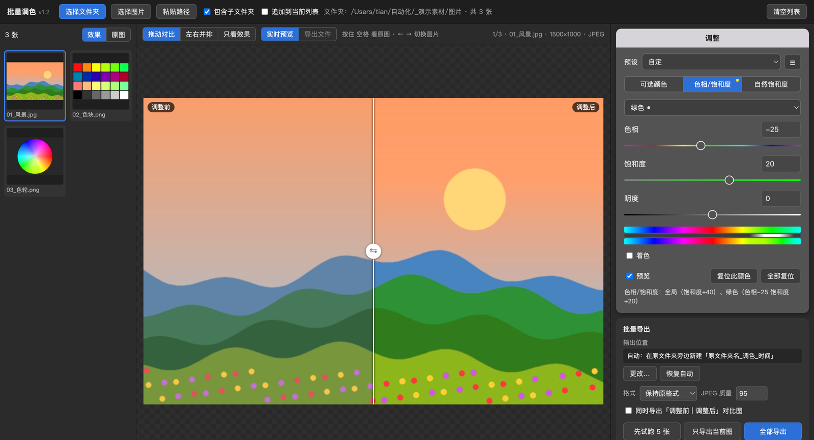

# 批量调色：可选颜色 · 色相/饱和度 · 自然饱和度

把 Photoshop「图像 › 调整」里的 **可选颜色、色相/饱和度、自然饱和度** 批量套到一个文件夹或多张图片上，调参时实时看调整前后对比，效果与 PS 一致（误差见下文）。

在自己电脑上运行（Mac 双击即用），图片不会上传到任何地方；导出到新文件夹，**原图不会被修改**。



| 功能 | 说明 |
|---|---|
| 可选颜色 | 红 / 黄 / 绿 / 青 / 蓝 / 洋红 / 白 / 中性 / 黑 九种颜色，青色 / 洋红 / 黄色 / 黑色，相对 / 绝对 |
| 色相/饱和度 | 和 PS 一样的下拉框：「全局颜色（主要）」调整整张图，或只调某一种颜色；支持「着色」；带调整前后色带 |
| 自然饱和度 | 自然饱和度 + 饱和度（Camera Raw 里也是这两项） |
| 叠加使用 | 三种调整可以一起用，按 可选颜色 → 色相/饱和度 → 自然饱和度 的顺序处理 |
| 前后对比 | 拖动分割线 / 左右并排 / 按住空格看原图；缩略图显示调整后效果 |
| 批量导出 | 先试跑 5 张，再全部导出；保留子文件夹结构、原格式、ICC、EXIF、DPI；可同时导出「调整前 \| 调整后」拼图 |
| 预设 | 三种调整一起存；可选颜色可载入 / 导出 PS 的 .asv 预设 |

---

## 下载与安装（Mac）

1. 到 [Releases](../../releases) 下载最新的 `ps-color-batch-v*.zip`，解压后得到「可选颜色批处理」文件夹。
2. 双击文件夹里的 **`启动.command`**。
   - 第一次打开会自动安装运行环境（需联网，约 1～3 分钟，只需要一次）。
   - 提示「无法验证开发者」：先点「完成 / 取消」，打开 **系统设置 → 隐私与安全性**，拉到最下面点 **「仍要打开」**，再双击一次（旧版 macOS 可以右键 → 打开 → 再点「打开」）。
   - 还是打不开：打开「终端」，输入 `bash `（后面有空格），把 `启动.command` 拖进去，按回车。
   - 电脑上没有 Python 时会自动打开 Python 官网，安装 Python 3.12 后再双击一次。
3. 浏览器会自动打开 <http://127.0.0.1:8790>。使用期间不要关掉终端窗口。

手动启动：

```bash
python3 -m venv .venv
.venv/bin/pip install -r requirements.txt
.venv/bin/python app.py
```

支持 Python 3.9 ～ 3.14，浏览器推荐 Chrome（Edge、Safari 也可以）。

## 使用

1. 点 **「选择文件夹」** 或 **「选择图片」**（可多选）；共享盘路径可以在访达里按 `⌥ Option + ⌘ Command + C` 复制后点「粘贴路径」。
2. 在右侧「调整」里选页签调参数，三种可以只用一种，也可以叠加。
3. 点 **「先试跑 5 张」** 看效果，满意后点 **「全部导出」**。
   默认输出到原文件夹旁边新建的 `原文件夹名_调色_时间`，同名文件不覆盖，每次导出附 `处理记录.json`。

详细说明见 [使用说明.md](使用说明.md)。

## 和 PS 的效果一致吗

算法移植自开源项目 [OpenPhoto](https://github.com/yuanzhixiang/openphoto)，它的作者用 Photoshop 2026 的实际输出拟合了这些调整。
本工具用该仓库里 PS 导出的 21 组对照数据验证（0～255 色阶）：

| 调整 | 与 PS 的最大差别 |
|---|---|
| 可选颜色 | 不超过 1 个色阶 |
| 色相/饱和度 · 全局颜色 | 1～4 个色阶 |
| 色相/饱和度 · 单个颜色 | 不超过 4 个色阶（差 2 以上的只是两种颜色交界处的少数像素） |
| 色相/饱和度 · 着色 | 不超过 3 个色阶 |
| 自然饱和度 · 饱和度 | 不超过 1 个色阶 |
| 自然饱和度 · 自然饱和度 | 没有 PS 对照数据，是近似算法，方向一致、数值有差别 |

自己验证：

```bash
python3 tests/verify_against_photoshop.py   # Python 导出算法 vs PS
node tests/verify_js.js                      # 浏览器预览算法 vs PS
python3 tests/cross_check.py                 # 预览与导出两套算法互相对照
```

## 注意事项

- 支持 JPG、PNG、TIFF、WebP、BMP；HEIC、PSD、GIF、RAW 不支持。CMYK 图会跳过（请先在 PS 里转 RGB），16 位图输出为 8 位。
- 预览不做色彩管理，Adobe RGB 等图在预览里会偏淡；导出按原始数值计算并保留原色彩配置，与 PS 一致。
- Camera Raw 的曝光、对比度、高光、阴影、色温等是 Adobe 私有算法，没有做。
- PS 的色相/饱和度预设（.ahu）暂不支持载入。

## 许可

调整算法和 `tests/fixtures/` 下的 PS 对照数据来自 [OpenPhoto](https://github.com/yuanzhixiang/openphoto)（MIT），许可声明见 [第三方许可-OpenPhoto-MIT.txt](第三方许可-OpenPhoto-MIT.txt)。
